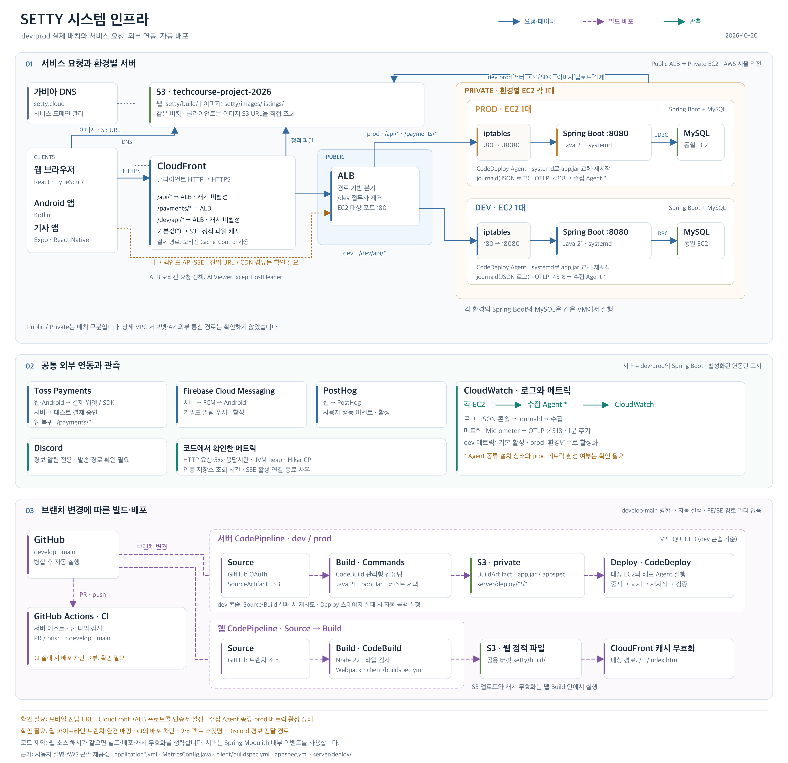
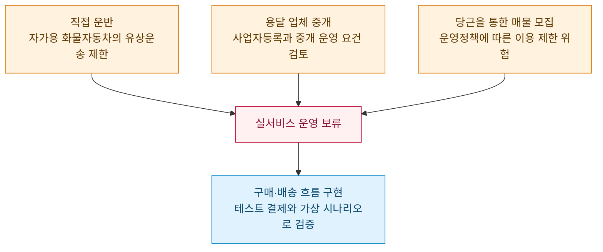

  
  <h1>SETTY</h1>
  
<strong>중고 가구를 고르는 순간, 배송까지 생각합니다.</strong>

  
매물 탐색 · 배송비 확인 · 결제를 하나의 거래 흐름으로

---

## 🪑 가구 거래가 멈추는 지점

당근의 [2025 연말결산](https://about.daangn.com/company/pr/archive/%EB%8B%B9%EA%B7%BC-2025-%EC%97%B0%EB%A7%90%EA%B2%B0%EC%82%B0-%EB%8D%B0%EC%9D%B4%ED%84%B0-%EA%B3%B5%EA%B0%9C/)에서 **가구·인테리어는 나눔이 가장 많았던 물품 카테고리**였습니다. 이 자료만으로 나눔의 원인을 단정할 수는 없습니다. SETTY는 가구 거래에서 가격만큼이나 운송을 결정하기 어렵다는 문제에 주목합니다.

가구는 부피와 무게 때문에 구매 후 운송 계획이 필요합니다. 차량이 없는 구매자는 마음에 드는 매물을 발견해도 판매자와 일정을 맞추고, 운송 견적을 받고, 운송을 별도로 신청해야 합니다. 저렴한 매물을 찾은 뒤에도 **최종 비용과 배송 가능 여부를 바로 알기 어렵습니다.**

| 기존 · 플랫폼을 오가는 거래 | SETTY · 한 흐름에서 진행 |
| :---: | :---: |
| **중고거래 플랫폼** · 매물 탐색 ↓ **판매자** · 거래 조율 ↓ **용달 서비스** · 운송 견적 ↓ **판매자** · 일정 재조율 ↓ **중고거래 플랫폼** · 물품 대금 송금 ↓ **용달 서비스** · 운송 신청·결제 ↓ 배송 | 매물 탐색 ↓ 예상 배송비·총액 확인 ↓ 가구·배송비 함께 결제 ↓ 배송 요청 ↓ 배송 |

결제까지 걸리는 시간도 이 흐름을 설계할 때 고려했습니다.
Stripe의 2022년 일반 전자상거래 결제 조사에서 아시아·태평양 응답자의 49%는 3분, 북미의 52%와 유럽의 62%는 2분이 지나면 구매를 포기한다고 답했습니다. ([아시아·태평양](https://stripe.com/guides/state-of-asia-pacific-checkouts-2022) · [북미](https://stripe.com/guides/state-of-north-american-checkouts-2022) · [유럽](https://stripe.com/guides/state-of-european-checkouts-2022))

SETTY는 구매자가 판매자와 운송 서비스를 오가며 직접 조율해야 하는 단계를 줄입니다.

## 🛒 한 흐름에서 끝내는 구매

1. **발견** — 중고 가구 매물을 둘러보고 상세 정보를 확인합니다.
2. **확인** — 상세 화면에서 매물 가격, 예상 배송비, 총 결제 금액을 함께 봅니다.
3. **결제** — 가구 비용과 배송비를 한 번에 결제합니다.
4. **배송** — 결제 확정 후 배송 요청이 생성되고, 기사가 요청을 수락해 배송을 진행합니다.

> [!NOTE]
> **현재 구현 범위**: 예상 배송비는 주소 기반 용달 견적이 아니라 **가구의 크기(부피)에 따른 정액 정책**으로 계산합니다. 결제 후 배송 요청과 기사 수락 흐름은 구현되어 있습니다. 주소 기반 견적과 자동 차량 매칭은 아직 구현되지 않았습니다.

## 🗂️ 저장소 둘러보기

| 경로 | 역할 | 기술 |
| :-- | :-- | :-- |
| [`client/`](client/) | 구매자·판매자 모바일 웹, 매물 탐색과 결제 | React · TypeScript · Webpack |
| [`android/`](android/) | Android 앱, 매물 탐색과 판매자 화면 | Kotlin · Jetpack Compose |
| [`apps/driver/`](apps/driver/) | 기사 앱, 요청 수락부터 배송 완료까지 | Expo · React Native · TypeScript |
| [`server/`](server/) | 회원·매물·주문·결제·배송 API | Java 21 · Spring Boot · MySQL |
| [`docs/policy/`](docs/policy/README.md) | 주문·결제·배송의 상태와 서비스 정책 | Markdown |

### 코드에서 확인하는 핵심 흐름

- [배송비 정책](server/src/main/java/setty/platform/listing/domain/DeliveryFeePolicy.java): 가구 부피에 따라 예상 배송비를 계산합니다.
- [매물 상세](client/src/features/listingdetail/FurnitureDetailScreen.tsx): 매물 가격, 배송비, 총액을 함께 표시합니다.
- [결제 화면](client/src/features/payment/PaymentScreen.tsx): 주문을 생성하고 결제 위젯을 엽니다.
- [배송 정책](docs/policy/delivery.md): 결제 확정 이후 배송 요청과 상태 전이를 정의합니다.

## 📚 문서와 협업

- [서비스 정책](docs/policy/README.md): 주문·결제·배송의 확정 규칙과 미정 항목
- [결제 전환 시나리오 테스트](scripts/payment-conversion/README.md): 테스트 스크립트 인덱스와 계정·매물 준비 및 실행 방법
- [기사 앱 문서](apps/docs/README.md): 앱 구조, API 매핑, 확인할 사항
- [CI](.github/workflows/ci.yml): 서버 테스트와 웹 타입 검사

## 이벤트 지도와 토폴로지

세티에서 구현된 [이벤트 지도와 토폴로지](https://claude.ai/artifact/KJcVmc6GSjzTW591XBcJuX)를 상세하게 확인할 수 있습니다.

| 이벤트 지도 | 토폴로지 |
| --- | --- |
|  |  |

## 시스템 인프라와 배포 파이프라인

dev·prod는 각각 EC2 한 대에서 Spring Boot와 MySQL을 함께 실행합니다. 그림에는 서비스 요청, 공통 외부 연동과 관측, 빌드·배포 흐름을 구분했습니다. 확인이 필요한 설정은 그림에 표시했습니다.

[확대 가능한 SVG 원본](docs/images/system-infrastructure.svg)

---

## 🧭 실서비스 운영을 보류한 이유

> [!IMPORTANT]
> **SETTY는 실제 결제와 가구 운송을 수반하는 실서비스 운영을 진행하지 않기로 했습니다.**
> 직접 운반의 법적 조건, 거래·운송 중개에 필요한 운영 요건, 초기 매물 확보 경로의 제약을 고려해 프로젝트 기간에는 **구매부터 배송 완료까지의 시스템 구현과 테스트 환경의 검증**에 집중했습니다.

실거래가 성립하려면 판매자·구매자·배송원을 같은 지역과 일정에 맞춰 연결하고, 배송과 거래 중 발생하는 문제에도 대응해야 합니다. 팀은 이러한 운영 준비와 개발을 함께 수행하는 비용을 고려해 전체 거래 흐름을 구현하는 범위를 선택했습니다.

법령·정책의 적용 조건과 운영 보류의 결정 과정은 위키에, 스프린트별 관측 결과와 해석 범위는 유저 데이터 리포트에 기록했습니다.

| 기록 | 확인할 내용 |
| :-- | :-- |
| 🧭 [실서비스 운영 보류 배경](https://github.com/woowacourse-teams/2026-setty/wiki/SETTY%EC%9D%98-%EC%8B%A4%EC%84%9C%EB%B9%84%EC%8A%A4-%EC%9A%B4%EC%98%81-%EB%B3%B4%EB%A5%98-%EB%B0%B0%EA%B2%BD) | 직접 운반·용달 중개·매물 모집의 제약, 개발 범위 전환과 운영 재검토 조건 |
| 📊 [유저 데이터 리포트](https://conscious-garlic-b97.notion.site/3eb2dbc171878094a3a0d075fa917ae1?source=copy_link) | 스프린트별 가상 시나리오, 결제 기준 WAU·전환율과 판매자 상태 재확인 관측 |

가상 시나리오에서 확인한 범위

결제 승인부터 주문 확정, 배차 요청·수락, 배송 완료 상태 처리와 판매 완료 반영까지 이어지는 흐름과 이벤트 수집을 확인했습니다.

**리포트의 WAU와 전환율은 테스트 결제·가상 트래픽 기준입니다.** 사전에 지정한 행동을 실행한 결과이므로 실제 사용자의 결제 의사, 실제 가구 운송, 제품 개선 효과를 입증하는 데이터로 해석하지 않습니다.

