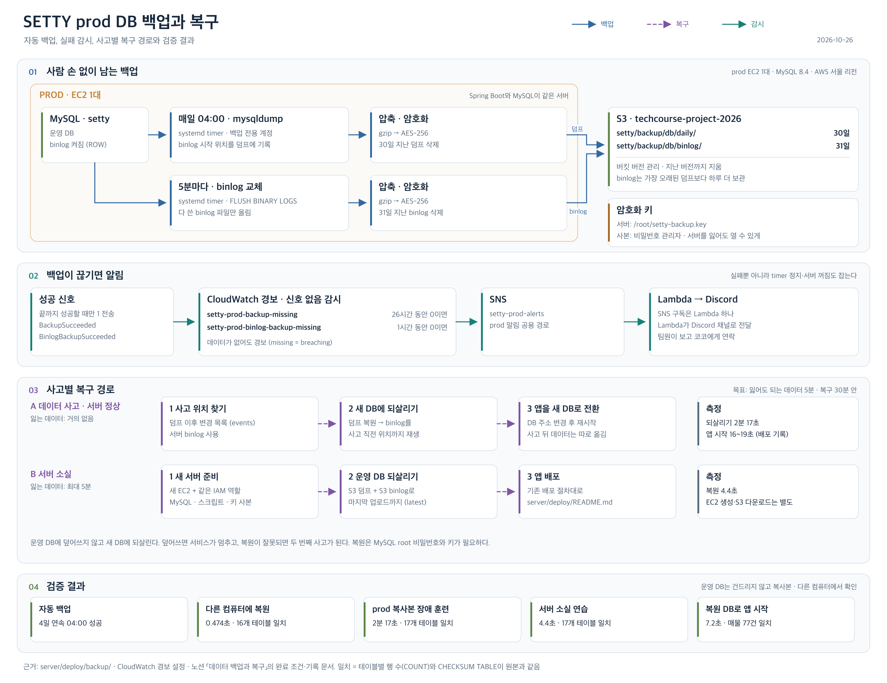

# prod DB 백업

prod MySQL `setty` 스키마를 매일 04:00 KST에 덤프해 암호화한 뒤 S3에 올린다. 변경 기록(binlog)은 5분마다 올려, 덤프 위에 다시 적용해 실수 직전 시점으로 되살린다. 이 폴더의 파일은 CodeDeploy 배포 대상이 아니며, 서버에 한 번 손으로 설치한다.



[확대 가능한 SVG 원본](../../../docs/images/backup-recovery.svg)

| 파일 | 서버 위치 | 역할 |
| --- | --- | --- |
| `setty-backup.sh` | `/opt/setty/backup/` | 덤프(binlog 시작 위치 포함) → gzip → 암호화 → S3 업로드 → 30일 지난 백업 삭제 |
| `setty-restore.sh` | `/opt/setty/backup/` | S3 객체 또는 로컬 파일을 복호화해 새 DB로 복원 |
| `setty-binlog-backup.sh` | `/opt/setty/backup/` | binlog를 새 파일로 교체하고 다 쓴 파일 중 안 올린 것을 gzip → 암호화 → S3 업로드, 하루 한 번 31일 지난 binlog 삭제 |
| `setty-pitr-restore.sh` | `/opt/setty/backup/` | 덤프를 새 DB로 복원하고 binlog를 고른 위치 직전까지 재생 |
| `setty-backup.service` | `/etc/systemd/system/` | 백업 스크립트를 1회 실행 |
| `setty-backup.timer` | `/etc/systemd/system/` | 매일 04:00 Asia/Seoul에 서비스 실행 |
| `setty-binlog-backup.service` | `/etc/systemd/system/` | binlog 백업 스크립트를 1회 실행 |
| `setty-binlog-backup.timer` | `/etc/systemd/system/` | 5분마다 서비스 실행 |

## 백업 위치와 보관 기간

매일 한 부를 `s3://techcourse-project-2026/setty/backup/db/daily/`에 올리고 30일 동안 보관한다. 버킷 버전 관리가 켜져 있어, 스크립트는 30일 지난 객체의 이전 버전과 삭제 마커까지 지운다.

binlog는 5분마다 `s3://techcourse-project-2026/setty/backup/db/binlog/`에 `<마지막으로 쓴 시각>-binlog.<번호>.gz.enc`로 올리고 31일 동안 보관한다. 가장 오래된 덤프(30일 전)에서 되살릴 때도 그 뒤 binlog가 빠지지 않게 하루 더 둔다. 서버가 마지막으로 올린 파일 이름은 `/var/lib/setty-backup/binlog-last-uploaded`에 남는다.

### 왜 30일인가

백업은 실수로 지우거나 망가진 데이터를 되돌리기 위한 사본이다. 실수는 보통 며칠 안에 발견되므로 30일이면 충분하다고 보았다.

더 오래 두지 않는 이유는 개인정보 때문이다. 백업 파일에는 회원 전화번호와 주소까지 DB 전체가 들어 있어, 백업을 오래 둘수록 탈퇴한 회원의 정보도 그만큼 남는다. 개인정보 보호법 제21조는 필요 없어진 개인정보를 지체 없이 파기하도록 한다. 백업을 30일만 두면 탈퇴 회원의 정보가 백업에 남는 기간도 최대 30일이 된다.

### 거래 기록 보존 의무와의 관계

전자상거래법은 사업자에게 거래 기록을 정해진 기간 동안 보존하도록 한다(법 제6조, 시행령 제6조).

| 기록 | 보존 기간 |
| --- | --- |
| 표시·광고 | 6개월 |
| 계약 또는 청약철회 | 5년 |
| 대금결제 및 재화 공급 | 5년 |
| 소비자 불만 또는 분쟁 처리 | 3년 |

이 의무는 DB 전체 백업을 5년 들고 있는 방식으로 지키는 것이 아니다. 해당 거래 기록만 골라 정해진 기간 동안 남겨 두는 방식으로 지킨다. 개인정보 보호법 제21조도 다른 법에 따라 보존해야 하는 정보는 파기하지 않아도 되지만, 다른 개인정보와 분리해 보관하도록 한다. 그래서 거래 기록 보존은 이 백업과 별개의 일이다.

현재 서버 코드에는 주문·결제·배송·정산 기록을 지우는 기능이 없어, 이 기록은 운영 DB에 계속 남는다. 회원 탈퇴(#574)는 회원 행의 아이디·전화번호·주소를 가리지만, 주문에 스냅샷으로 남은 배송지·전화번호를 포함한 거래 기록은 그대로 둔다. 거래 기록을 다른 데이터와 분리해 정해진 기간 동안 보존한 뒤 지우는 일은 아직 하지 않는다.

## 서버 설치

root 셸(`sudo -i`)에서 진행한다.

1. 스크립트와 systemd 파일을 위 표의 위치에 복사하고 스크립트에 `chmod 700`을 준다.
2. 암호화 키를 만든다. 키 사본은 서버 밖 비밀번호 관리자에 따로 보관한다.

   ```bash
   openssl rand -base64 32 > /root/setty-backup.key && chmod 600 /root/setty-backup.key
   ```

3. 백업 계정을 만들고 접속 정보를 `/root/.my.cnf`(600)에 둔다. prod MySQL에는 비밀번호 정책이 있어 대문자, 소문자, 숫자, 특수문자를 모두 넣어야 한다. `RELOAD`는 binlog를 교체하고 덤프 시작 위치를 고정하는 데, `REPLICATION CLIENT`는 binlog 목록과 위치를 보는 데 쓴다. 둘 다 데이터를 바꾸지 못한다.

   ```bash
   PW="$(openssl rand -base64 24 | tr -d '/+=' | cut -c1-20)"'Aa1_'
   printf '[client]\nuser=setty_backup\npassword="%s"\n' "$PW" > /root/.my.cnf && chmod 600 /root/.my.cnf
   printf "CREATE USER IF NOT EXISTS 'setty_backup'@'localhost' IDENTIFIED BY '%s';\nGRANT SELECT, SHOW VIEW, TRIGGER, EVENT, LOCK TABLES ON setty.* TO 'setty_backup'@'localhost';\nGRANT RELOAD, REPLICATION CLIENT ON *.* TO 'setty_backup'@'localhost';\nFLUSH PRIVILEGES;\n" "$PW" | mysql -uroot -p
   unset PW
   ```

   계정이 이미 있으면 권한만 더한다.

   ```bash
   mysql -uroot -p -e "GRANT RELOAD, REPLICATION CLIENT ON *.* TO 'setty_backup'@'localhost'"
   ```

4. 손으로 1회 실행해 S3에 파일이 올라가는지 확인한 뒤 timer를 켠다. 서버 시계가 UTC라 다음 실행은 19:00 UTC로 표시된다.

   ```bash
   systemctl daemon-reload && systemctl start setty-backup.service
   journalctl -u setty-backup.service --no-pager -n 20 -o cat
   systemctl enable --now setty-backup.timer
   systemctl show setty-backup.timer -p NextElapseUSecRealtime
   ```

5. binlog 백업도 손으로 1회 실행해 확인한 뒤 timer를 켠다. 첫 실행은 서버에 남아 있는 다 쓴 binlog를 모두 올린다.

   ```bash
   systemctl daemon-reload && systemctl start setty-binlog-backup.service
   journalctl -u setty-binlog-backup.service --no-pager -n 20 -o cat
   systemctl enable --now setty-binlog-backup.timer
   ```

## 실패 알림

백업이 끝까지 성공하면 스크립트가 CloudWatch `Setty/Prod` 이름공간에 `BackupSucceeded = 1`을 보낸다. CloudWatch 알람이 26시간 동안 이 값의 합이 1보다 작으면 prod 알림 경로로 알린다. 04:00 실행이 조금 늦어도 잘못 울리지 않게 하루보다 2시간 넉넉하게 둔다. 백업이 중간에 실패한 경우뿐 아니라 timer가 멈추거나 서버가 꺼져 백업이 아예 돌지 않은 경우도 잡는다.

binlog 백업은 성공할 때마다 `BinlogBackupSucceeded = 1`을 보낸다. 1시간 동안 이 값이 한 번도 없으면 알린다.

시험용으로 다른 경로에 백업을 돌릴 때는 `METRIC_NAMESPACE=` 를 비워 성공 지표를 보내지 않는다.

```bash
PREFIX=setty/backup/prune-test KEEP_DAYS=0 METRIC_NAMESPACE= /opt/setty/backup/setty-backup.sh
```

## 확인과 복구

- 백업이 돌았는지: `aws s3 ls s3://techcourse-project-2026/setty/backup/db/daily/`
- 실패 원인: `journalctl -u setty-backup.service --no-pager -n 30`
- 새 DB로 복원: `sudo /opt/setty/backup/setty-restore.sh setty/backup/db/daily/<파일 이름> <새 DB 이름>`
  - 실행하면 MySQL root 비밀번호를 묻는다. 백업 계정은 읽기 전용이라 복원에 쓸 수 없다.
  - 운영 DB(`setty`)와 이미 있는 DB에는 복원하지 않는다.
  - 키나 파일이 잘못되면 DB를 만들기 전에 멈춘다. 내려받은 파일은 끝나면 지운다.
- 특정 시점으로 되살리기: 덤프 이후 삭제·수정을 보고, 되돌릴 묶음의 파일과 위치를 골라 그 직전까지 새 DB에 복원한다.

  ```bash
  sudo /opt/setty/backup/setty-pitr-restore.sh events setty/backup/db/daily/<파일 이름>
  sudo /opt/setty/backup/setty-pitr-restore.sh restore setty/backup/db/daily/<파일 이름> <새 DB 이름> <binlog 파일> <위치>
  ```

  - 멈출 곳은 시각이 아니라 위치로 고른다. 같은 초에 여러 변경이 기록될 수 있다.
  - 기본은 서버 디스크의 binlog를 쓴다. 서버를 잃었을 때는 `BINLOG_SOURCE=s3`를 앞에 붙인다. 이때는 마지막 업로드 뒤 최대 5분의 변경이 없다.
  - binlog 시작 위치가 적힌 덤프부터 쓸 수 있다. 사고 뒤 들어온 데이터는 복원본에 없으므로 따로 옮긴다.
  - `mysql -e "DROP TABLE setty.x"`처럼 DB 이름을 붙여 실행한 DDL은 새 DB로 바꿔 재생할 수 없다. 멈출 위치 전에 있으면 복원하지 않고 알리므로, 그 DDL 직전까지 복원한 뒤 나머지는 팀과 손으로 처리한다.
  - 재생 완료 메시지 없이 끝나면 새 DB가 반쯤 채워져 있다. 그 DB를 지우고 다시 실행한다.

- 서버를 통째로 잃었을 때: 새 서버에 MySQL과 이 폴더의 스크립트, 암호화 키를 설치한 뒤, 가장 최근 덤프와 S3의 binlog로 운영 DB를 끝까지 되살린다. 새 서버 모드는 대상 DB가 아직 없을 때만 운영 DB 이름을 허용한다.

  ```bash
  sudo NEW_SERVER=1 BINLOG_SOURCE=s3 /opt/setty/backup/setty-pitr-restore.sh restore setty/backup/db/daily/<파일 이름> setty latest
  ```

prod DB 자체를 백업으로 덮어쓰는 절차는 아직 검증하지 않았다. 필요하면 혼자 진행하지 말고 팀과 먼저 상의한다.
