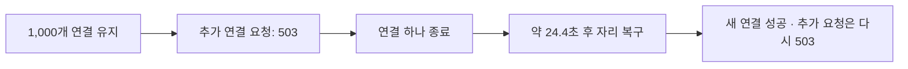

# 로컬 SSE 1,000개 연결 테스트 결과

**로컬 기능 검증은 통과했다.** 1,000개 연결을 45초 유지했고, 상한 초과 거부와 연결 정리 후 재접속을 확인했다. PR 머지와 dev 실행은 보류했다.

## 무엇을 확인했는가

배송 요청 목록의 SSE는 서버가 열린 HTTP 연결로 변경 신호를 보내는 기능이다. 이번 시험은 연결 1,000개를 유지할 수 있는지, 그보다 많은 연결 요청을 거부하는지, 연결 하나가 종료되면 자리를 다시 사용할 수 있는지 확인했다.

| 실행 조건 | 값 |
| --- | --- |
| 실행일 | 2026-10-13, 12:57~13:00 KST |
| Spring 코드 | `3aa2795` 기준 |
| 환경 | macOS의 로컬 Spring Boot, Java 21.0.5, Node 22.23.2 |
| DB | MySQL 8.4.11의 임시 테스트 DB |
| JVM 힙 설정 | 초기 128MiB · 최대 512MiB |
| 기사 데이터 | 테스트 전용 기사 1,002명 |
| 본 부하 | 서로 다른 기사 1,000명이 각각 연결 1개 |
| 연결 시작·유지 | 20초에 걸쳐 연결 → 1,000개 도달 후 45초 유지 |
| 서버 상한 | 기사당 최대 2개 · 전체 최대 1,000개 |
| 함께 수행한 동작 | heartbeat, 약 500ms 간격의 목록 조회 |

변경 이벤트 발생률은 0으로 유지했다. 모든 기사 앱이 동시에 목록을 조회하거나 변경 알림을 받는 조건은 포함하지 않았다.

## 연결 유지·거부·복구 결과

| 확인 항목 | 결과 |
| --- | --- |
| 목표 구간 연결 유지 | 자원 표본 10회 모두 클라이언트 기준 1,000개 |
| 예상하지 못한 단절 | 0건 |
| 같은 기사의 세 번째 연결 | 429 JSON, `DRIVER_LIMIT_EXCEEDED` |
| 전체 상한 초과 요청 | 503 JSON, `TOTAL_LIMIT_EXCEEDED` |
| 연결 하나 종료 후 새 연결 | 약 24.355초 후 성공. 500ms 간격으로 48회 시도 |
| 복구 후 다시 초과 요청 | 503으로 거부 |
| heartbeat 수신 | 전체 시험 구간에서 5,696개 |

클라이언트가 연결을 닫아도 서버가 즉시 자리를 비우지는 않았다. 정상 heartbeat 쓰기로 단절을 확인한 뒤 새 연결을 허용했다. 이번 복구 시간은 이 확인 지연을 포함한다.

## 목록 API 지연과 서버 메모리

| 목록 API 측정 구간 | 호출 수 | P50 | P95 | P99 |
| --- | ---: | ---: | ---: | ---: |
| 본 부하 이전 | 20회 | 6.195ms | 12.185ms | 43.083ms |
| 1,000개 유지 중 | 84회 | 18.633ms | 40.177ms | 203.437ms |
| 재접속 성공 후 | 1회 | 13.667ms | 13.667ms | 13.667ms |

모든 목록 조회는 200 배열 응답이었다. 복구 후 1회는 단일 응답 시간이며 지연 분포로 해석하지 않는다. 수치 기준을 합의하지 않았으므로 지연은 관측값으로 기록한다. 조회된 배송 요청 목록은 비어 있어 큰 목록의 조회 비용은 검증하지 않았다.

| 메모리 측정 구간 | 힙 사용량 | 프로세스 RSS |
| --- | ---: | ---: |
| 본 부하 이전 | 72.7MiB | 148.0MiB |
| 1,000개 유지 중 표본 최댓값 | 182.5MiB | 256.4MiB |
| 전체 연결 종료·31초 대기 후 | 224.2MiB | 201.4MiB |

힙은 JVM이 객체에 사용하는 메모리이고, RSS는 프로세스가 실제 메모리에 올린 영역의 크기다. `jcmd GC.heap_info`와 `ps`로 표본을 수집했다. 강제 GC는 실행하지 않았으므로 종료 후 힙이 남았다는 사실만으로 누수라고 판단하지 않는다.

## 준비 단계에서 확인한 정리 지연

첫 실행은 초기 점검 연결을 닫고 16초 뒤 본 연결을 시작했지만 첫 요청이 429로 거부됐다. heartbeat 한 번이면 이전 연결이 반드시 정리된다는 가정이 맞지 않았다.
준비·종료 대기를 31초, 복구 대기를 최대 40초로 바꾼 뒤 본 시험이 통과했다. 서버 동작 코드는 바꾸지 않았다. 스크립트 판정용 모의 HTTP 테스트도 3개 통과했다.

## 적용 범위와 정리 상태

- **확인 완료:** 이 로컬 환경의 1,000개 연결 유지, 429·503 거부, 자리 복구, 목록 API 응답과 서버 메모리 표본.
- **확인 필요:** dev·운영 환경, 실제 앱 화면 복구, 대량 변경 이벤트와 동시 목록 조회, 120초 만료 이후 장시간 재접속.
- 부하 생성기와 서버가 같은 PC를 사용했다. 이번 결과만으로 운영 상한 1,000개의 적정성을 확정하지 않는다.
- 테스트 기사 1,002명을 삭제해 DB 잔존 0명을 확인했고, 전용 Spring Boot와 MySQL 컨테이너를 종료했다.
- 원시 집계는 같은 폴더의 `sse-connection-load-local-2026-10-13.json`, 스크립트와 실행 안내는 `performance/`에 보관한다.
